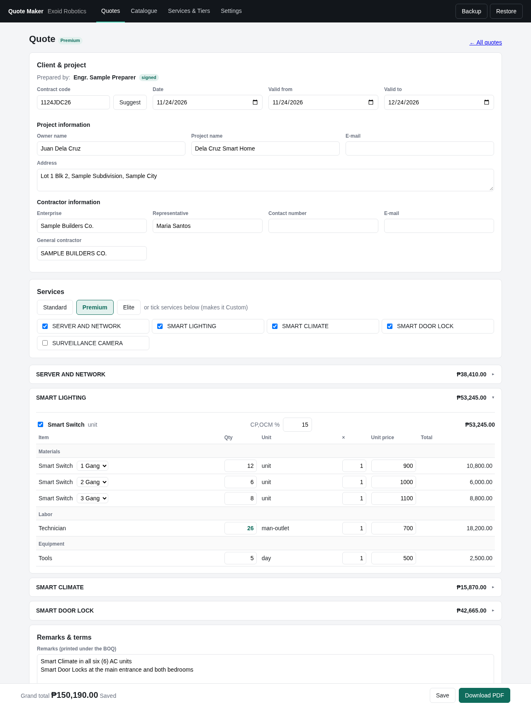
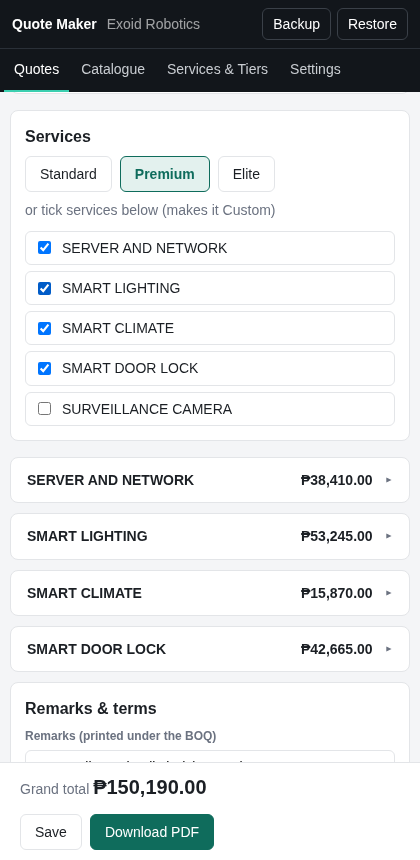

# Quote Maker

**Live app: https://riegojerey.github.io/quotemaker/**

Smart home quotations for Exoid Robotics Home Automation Services. Tick services or pick a tier
(Standard / Premium / Elite), type device counts, and download one signed PDF: Bill of Quantities,
Proforma Invoice and a Detailed Unit Price Analysis (DUPA) page per service.

> Screenshots use made-up sample prices and a sample client.

### Building a quote

Pick a tier or tick services, type device counts; labor follows the device count automatically
(edit it to override, ↺ to go back to auto). The grand total updates as you type.



### The PDF

Bill of Quantities and Proforma Invoice, then one DUPA page per service, each with the preparer's signature.


### Services & tiers

Set what each tier includes, and each service's items, sizes, default quantities and which labor lines follow which devices.


### On a phone



## Using it

- **Settings**: your name, title and signature (draw or upload), CP,OCM default, payment terms, company and bank details.
- **Catalogue**: selling prices. Items with sizes (Data Cabinet 4U / 6U / 12U) get one variant per size.
  Saved quotes keep the prices they were made with.
- **Services & Tiers**: what each service contains, default quantities, which labor lines follow the device count,
  and which services each tier ticks.
- **Quotes**: new, open, duplicate, delete. Download PDF from the quote.

## Your data stays in your browser

Nothing is sent anywhere. Prices, quotes and your signature live in this browser only; clearing browser data
deletes them. Use **Backup** to download a file, and **Restore** to load one:

- To share prices and templates with a coworker, send them a backup (leave "quotes" and "signature" unticked);
  they **Restore → Merge** and keep their own settings.
- Keep a backup with quotes ticked somewhere safe.

The app ships with no prices and no phone, email or bank account number: fill those in **Settings** once,
then share them with a backup (coworkers choose **Restore → Replace** to take your settings). Never commit backup files, workbooks or anything in `private/` to this repo.

## Development

No build step. Serve the folder with any static server:

```sh
python3 -m http.server 8000   # then open http://localhost:8000
npm test                      # node --test, pricing / model / backup / PDF tests
```

Import an existing BOQ/DUPA workbook into a backup file (local only, writes `private/`, git-ignored):

```sh
uv run --with openpyxl python tools/import_casa.py "<client> - BOQ_DUPA.xlsx"
```

The importer checks every pay item against the workbook's own totals and refuses to write the file if any differ.
