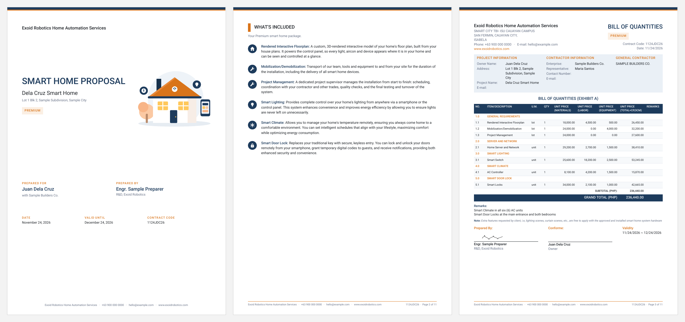
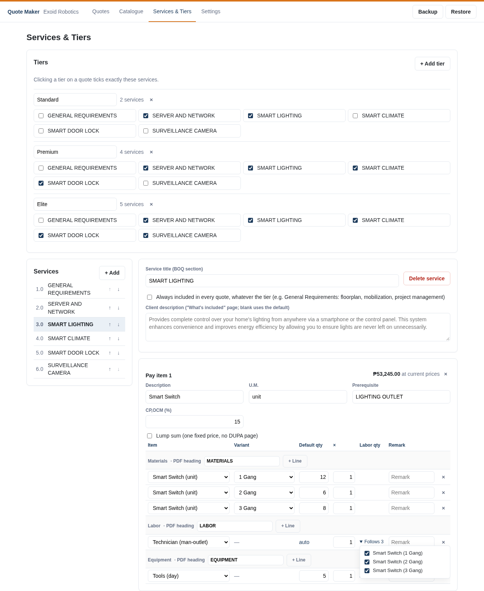

# Quote Maker

**Live app: https://riegojerey.github.io/quotemaker/**

Smart home quotations for Exoid Robotics Home Automation Services. Tick services or pick a tier
(Standard / Premium / Elite), type device counts, and download one signed, client-ready PDF: a cover,
a "What's included" page, the Bill of Quantities, Proforma Invoice and a Detailed Unit Price Analysis (DUPA)
page per pay item.

> Screenshots use made-up sample prices and a sample client.

### Building a quote

Pick a tier or tick services, type device counts; labor follows the device count automatically
(edit it to override, ↺ to go back to auto). The grand total updates as you type.

**General Requirements** (Rendered Interactive Floorplan, Mobilization/Demobilization, Project Management)
is on every quote, whatever the tier. The floorplan is priced per square meter: type the house's floor area
as its quantity. If the client does not avail an item, untick it on the quote: it is tagged *not availed*
and left out of the totals and the whole PDF (the remaining items renumber).


### The PDF

Navy and orange on white, in this order, one page each:

1. **Cover**: project, client, tier, preparer and dates (no prices).
2. **What's included**: one short paragraph per service, written for the homeowner, with no numbers or prices.
   Default texts are built in; change them per service under Services & Tiers → *Client description*.
   General Requirements lists its items one by one.
3. **Bill of Quantities** and **Proforma Invoice** (with payment terms and payment channel).
4. **DUPA**: one page per pay item, with the CP,OCM breakdown.

The BOQ, Proforma and DUPA pages carry the preparer's signature. Long quotes (16+ sections) use a tighter
table so each section still fits on one page. Add your logo in Settings.



### Services & tiers

Set what each tier includes, and each service's items, sizes, default quantities and which labor lines follow which devices.



### On a phone


## Using it

- **Settings**: your name, title and signature (draw or upload), CP,OCM default, payment terms, company and bank details.
- **Catalogue**: selling prices. Items with sizes (Data Cabinet 4U / 6U / 12U) get one variant per size.
  Saved quotes keep the prices they were made with.
- **Services & Tiers**: what each service contains, default quantities, which labor lines follow the device count,
  which services each tier ticks, each service's client description, and whether it is *always included*
  in every quote (General Requirements is, by default).
- **Quotes**: new, open, duplicate, delete. Download PDF from the quote.

## Built-in services and prices

The first time the app opens in a browser, it loads Exoid's services and selling prices from
[`defaults.json`](defaults.json) (catalogue, 16 services, tiers). From then on that browser keeps its own copy:
edits you make stay yours, and later changes to `defaults.json` do not overwrite them (use **Restore → Merge**
with a backup to take new prices). `defaults.json` is public; it holds no quotes, clients, signatures or contact details.

To update the built-in prices: in the app, **Backup** (quotes and signature unticked), then copy its `catalogue`,
`services` and `tiers` into `defaults.json` and commit.

## Your data stays in your browser

Nothing is sent anywhere. Quotes, edited prices and your signature live in this browser only; clearing browser data
deletes them (the built-in prices load again). Use **Backup** to download a file, and **Restore** to load one:

- To share prices and templates with a coworker, send them a backup (leave "quotes" and "signature" unticked);
  they **Restore → Merge** and keep their own settings.
- Keep a backup with quotes ticked somewhere safe.

The app ships with no phone, email or bank account number: fill those in **Settings** once,
then share them with a backup (coworkers choose **Restore → Replace** to take your settings). Never commit quotes,
backup files with quotes, workbooks or anything in `private/` to this repo.

## Development

No build step. Serve the folder with any static server:

```sh
python3 -m http.server 8000   # then open http://localhost:8000
npm test                      # node --test, pricing / model / backup / PDF tests
```

Import an existing BOQ/DUPA workbook into a backup file (local only, writes `private/`, git-ignored):

```sh
uv run --with openpyxl python tools/import_casa.py "<client> - BOQ_DUPA.xlsx"
```

The importer checks every pay item against the workbook's own totals and refuses to write the file if any differ.
